# CS320: Artificial Neural Networks & Deep Learning — Term Project Report
## Project P06: Pneumonia Classification with Limited Labeled Data (25% Budget)

**Institution:** National University of Sciences and Technology (NUST), SEECS, Department of Computing  
**Class:** BSAI-2k24, Fall 2026 | **Course:** CS320  
**Group:** P06 (Group Size: 3 Members: Sharjeel Farooq, Affan Ahmad, and Member 3)  
**Task:** 3-class mutually exclusive classification of pediatric chest X-rays (NORMAL, BACTERIA, VIRUS)  
**Training budget:** Exactly 25% of the official training split (1,103 images)  
**Models:** Scratch CNN baseline (93,635 params) vs. ImageNet-pretrained ResNet-18 (11.18M params) with staged fine-tuning  
**Evaluation:** Official validation split for checkpoint selection; official test split evaluated once per final model  

> **Educational use only:** This project is a machine-learning exercise and is not intended for clinical diagnosis, treatment, or deployment.

## Abstract

This project studies whether transfer learning and a carefully staged fine-tuning recipe can compensate for limited labeled data in pediatric chest X-ray classification. Using the MedIMeta pneumonia dataset, both models are trained on the same fixed, stratified 25% subset of the official training split (1103 images). The baseline is a 93,635-parameter scratch CNN trained with plain cross-entropy, no augmentation, no class weighting, and no label smoothing. The proposed model is an ImageNet-pretrained ResNet-18 trained in three stages (head, layer4, full network) with mild X-ray-safe augmentation, weighted cross-entropy, label smoothing, and discriminative layer learning rates. Over three seeds, the baseline reaches a test macro-F1 of 0.5855 ± 0.0964; the proposed model reaches 0.8347 ± 0.0077. A paired bootstrap over test images finds a positive proposed-minus-baseline macro-F1 difference for every seed (mean +0.249). The largest baseline failure is viral-to-bacterial confusion, which the proposed model substantially reduces. The results support the practical value of transfer learning under this limited-data budget, while the single-dataset design, moderate calibration, and incomplete ablation study limit the strength of the conclusions.

## 1. Introduction

Pediatric pneumonia is a common and clinically important diagnosis. Chest radiography is widely used, but distinguishing bacterial from viral pneumonia is difficult, and inter-reader agreement can be limited. Deep learning models trained on large labeled datasets have achieved strong performance on pneumonia detection, but in many realistic settings only a small fraction of the data is labeled. This project asks a narrow, reproducible question:

> Given only 25% of the available training split, how much does an ImageNet-pretrained ResNet-18 with staged fine-tuning improve over a scratch CNN designed for the same budget?

The comparison is deliberately controlled. Both models use the same fixed subset, the same official validation split for model selection, and the same one-time test evaluation protocol. The baseline is intentionally simple. The proposed model adds transfer learning and a small set of components that are standard in medical image classification: mild augmentation, class weighting for imbalance, label smoothing, and staged unfreezing.

## 2. Related work

Deep convolutional networks are the standard architecture for chest X-ray classification. CheXNet popularized chest X-ray pneumonia detection with a 121-layer DenseNet [1], and the Kermany pediatric pneumonia dataset provided an influential image-based benchmark [2]. Residual networks [3] remain a strong, computationally efficient backbone, especially when pretrained on ImageNet [4]. Transfer learning is particularly useful when labeled medical data are scarce, because low- and mid-level features learned from natural images transfer reasonably well to grayscale radiographs after normalization and channel replication.

Grad-CAM [5] is used here only as a qualitative sanity check, not as a validated localization method. Calibration is reported because a classifier can rank images well while producing overconfident probabilities [6]. The MedIMeta benchmark [7] supplies the standardized task labels and official splits used in this project.

## 3. Data

### 3.1 Dataset and splits

The MedIMeta `pneumonia` task (`disease class`) contains three classes: NORMAL, BACTERIA, and VIRUS. The official split files are used unchanged. The dataset is stored under `data/raw/pneumonia` and is accessed through the MedIMeta Python package.

| Split | NORMAL | BACTERIA | VIRUS | Total |
|---|---:|---:|---:|---:|
| Train | 1161 | 2107 | 1147 | 4415 |
| Validation | 188 | 431 | 198 | 817 |
| Test | 234 | 242 | 148 | 624 |

The test split is imbalanced: VIRUS has 148 images, compared with 234 NORMAL and 242 BACTERIA. Macro-averaged metrics are therefore reported alongside accuracy.

### 3.2 Fixed limited-data subset

The main experiments use a stratified 25% sample of the training split, drawn once with seed 42. The subset is stored in `data/splits/train25_seed42.json` and contains 1103 images: NORMAL 290, BACTERIA 526, VIRUS 287. Its maximum absolute class-proportion difference from the full training split is 0.0004. The same file is used by every baseline and proposed run, and it is never regenerated. Supplementary 10% and 100% subsets were created for a planned data-efficiency study but are not used in the reported results.

### 3.3 Preprocessing

Images are grayscale TIFFs. They are resized to 224×224, replicated to three channels, converted to tensors, and normalized. The baseline uses mean and standard deviation 0.5. The pretrained model uses ImageNet normalization. The baseline uses no augmentation. The proposed model uses mild augmentation: ±10° rotation, ±5% translation, 0.95–1.05 scale, and brightness/contrast jitter of 0.1. Horizontal flipping is intentionally disabled because left/right orientation is clinically meaningful in chest radiography.

## 4. Methods

### 4.1 Baseline: scratch CNN

The baseline has three convolutional blocks with 32, 64, and 128 filters. Each block uses a 3×3 convolution, ReLU, and 2×2 max pooling, followed by global average pooling and a linear layer with three outputs. It has 93,635 parameters. Training uses Adam with learning rate 1e-3, weight decay 0, batch size 16, and 20 epochs. The loss is unweighted cross-entropy with no label smoothing. The checkpoint with the best validation macro-F1 is kept.

### 4.2 Proposed: staged ResNet-18 fine-tuning

The proposed model is an ImageNet-pretrained ResNet-18 with dropout 0.2 before the classifier. Training is divided into three stages:

1. **Head (3 epochs).** Only the final fully connected layer is trainable. Learning rate 1e-3.
2. **Layer4 (4 epochs).** `layer4` and the classifier are trainable. Learning rate 1e-4, weight decay 1e-4.
3. **Full network (5 epochs).** All parameters are trainable. Base learning rate 1e-5, cosine schedule, and discriminative multipliers: 0.1 for `conv1`/`bn1` and `layer1`, 0.3 for `layer2`, 0.5 for `layer3`, 0.8 for `layer4`, and 1.0 for the classifier. Weight decay 1e-4.

The loss is weighted cross-entropy with class weights computed from the 25% training subset only, plus label smoothing 0.1. The best validation macro-F1 checkpoint is kept. All reported seeds use batch size 16.

### 4.3 Model selection and test protocol

Validation macro-F1 is the only selection criterion. `src/train.py` never loads the test split. After training, `src/evaluate.py` evaluates validation and test once and writes a `test_eval_done.json` marker. A second test evaluation is refused unless `--force` is passed; `--force` is intended only for repairing a broken evaluation.

### 4.4 Metrics and statistics

Accuracy, balanced accuracy, macro-F1, weighted F1, per-class precision/recall/F1, macro one-vs-rest AUROC, expected calibration error (ECE), and reliability bins are computed from saved predictions. Results over seeds are reported as mean ± sample standard deviation (`ddof=1`). A paired bootstrap over test images (2000 resamples per seed) estimates the distribution of the proposed-minus-baseline macro-F1 difference.

## 5. Results

### 5.1 Main test results

| Model | Accuracy | Balanced accuracy | Macro-F1 | Weighted F1 | Macro-AUROC | ECE |
|---|---:|---:|---:|---:|---:|---:|
| Baseline CNN | 0.6522 ± 0.0547 | 0.6063 ± 0.0853 | 0.5855 ± 0.0964 | 0.6226 ± 0.0806 | 0.8831 ± 0.0100 | 0.1117 ± 0.0029 |
| Proposed ResNet-18 | **0.8446 ± 0.0080** | **0.8377 ± 0.0069** | **0.8347 ± 0.0077** | **0.8469 ± 0.0081** | **0.9534 ± 0.0052** | **0.1002 ± 0.0017** |

Per-seed test macro-F1:

| Seed | Baseline | Proposed |
|---|---:|---:|
| 42 | 0.5296 | 0.8273 |
| 43 | 0.5299 | 0.8343 |
| 44 | 0.6968 | 0.8426 |

The proposed model improves the mean test macro-F1 by 0.249 absolute. Its seed-to-seed variance is also much lower (standard deviation 0.0077 vs. 0.0964), which is consistent with a more stable optimization path.

### 5.2 Per-class test performance

| Model | Class | Precision | Recall | F1 | AUROC (OvR) | Support |
|---|---|---:|---:|---:|---:|---:|
| Baseline | NORMAL | 0.8748 ± 0.0386 | 0.5969 ± 0.0793 | 0.7064 ± 0.0468 | 0.9113 ± 0.0108 | 234 |
| Baseline | BACTERIA | 0.6036 ± 0.1249 | 0.9201 ± 0.0482 | 0.7214 ± 0.0708 | 0.8929 ± 0.0137 | 242 |
| Baseline | VIRUS | 0.6152 ± 0.1072 | 0.3018 ± 0.3085 | 0.3285 ± 0.2169 | 0.8453 ± 0.0069 | 148 |
| Proposed | NORMAL | 0.9877 ± 0.0033 | 0.8063 ± 0.0258 | 0.8877 ± 0.0167 | 0.9845 ± 0.0015 | 234 |
| Proposed | BACTERIA | 0.8266 ± 0.0083 | 0.9118 ± 0.0086 | 0.8671 ± 0.0024 | 0.9545 ± 0.0087 | 242 |
| Proposed | VIRUS | 0.7090 ± 0.0114 | 0.7950 ± 0.0103 | 0.7495 ± 0.0041 | 0.9214 ± 0.0080 | 148 |

VIRUS is the hardest class for both models. The baseline has high BACTERIA recall but low VIRUS recall, suggesting a strong bias toward the majority bacterial class. The proposed model improves VIRUS recall from 0.3018 to 0.7950 and VIRUS F1 from 0.3285 to 0.7495.

### 5.3 Bacterial-versus-viral confusion

For seed 42, among test images whose true or predicted label is bacterial/viral:

| Model | Bacterial → viral | Viral → bacterial |
|---|---:|---:|
| Baseline | 0 / 233 (0.00%) | 117 / 141 (82.98%) |
| Proposed | 20 / 240 (8.33%) | 28 / 147 (19.05%) |

The baseline almost never predicts VIRUS for viral images. The proposed model reduces the viral-to-bacterial error rate by more than 60 percentage points. This is the clearest qualitative difference between the models.

### 5.4 Paired bootstrap

The paired bootstrap difference (proposed − baseline macro-F1) is positive for every seed:

| Seed | Mean difference | 95% interval |
|---|---:|---:|
| 42 | 0.2974 | [0.2543, 0.3414] |
| 43 | 0.3044 | [0.2600, 0.3468] |
| 44 | 0.1458 | [0.1058, 0.1860] |

The mean difference across seeds is +0.2492. The probability that the proposed model is better is 1.0 in each seed's bootstrap. Because the bootstrap resamples images rather than seeds, it describes uncertainty on this test set, not population-level uncertainty across hospitals or acquisition devices.

### 5.5 Calibration

The proposed model has a lower ECE (0.1002 vs. 0.1117), but both models are moderately miscalibrated. High AUROC with lower thresholded F1 indicates that ranking is easier than choosing the correct class at the default threshold. Predicted probabilities should not be interpreted as clinical risks.

### 5.6 Training behavior

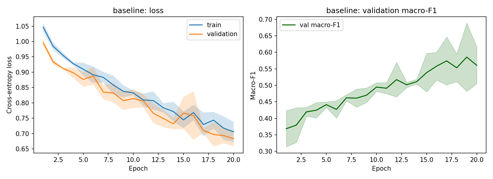

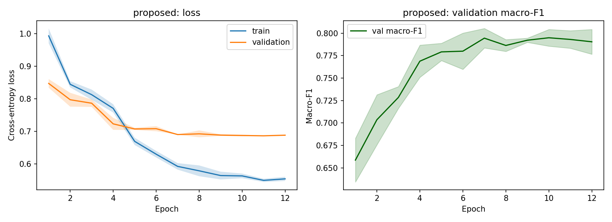

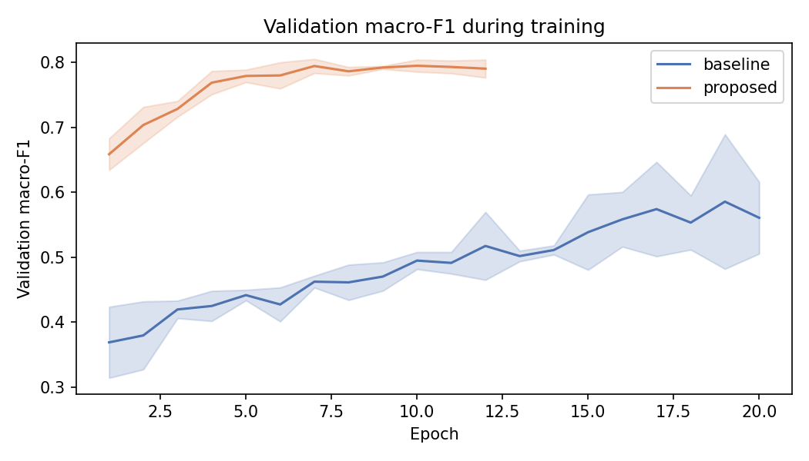

The baseline improves slowly and its validation macro-F1 remains below 0.62. The proposed model's validation macro-F1 rises sharply during the head and layer4 stages and plateaus around 0.80 during full fine-tuning. The proposed curves are also tighter across seeds.

### 5.7 Error analysis and Grad-CAM

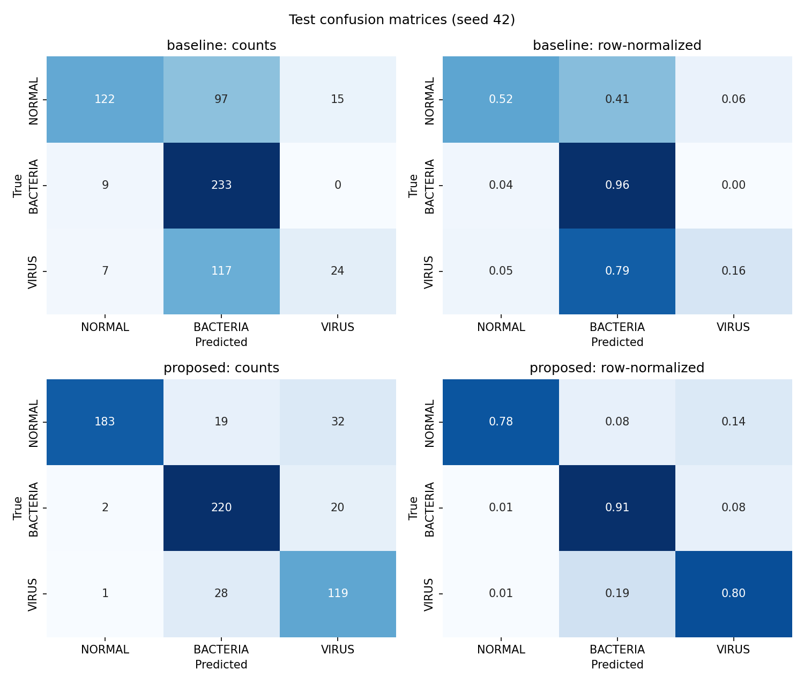

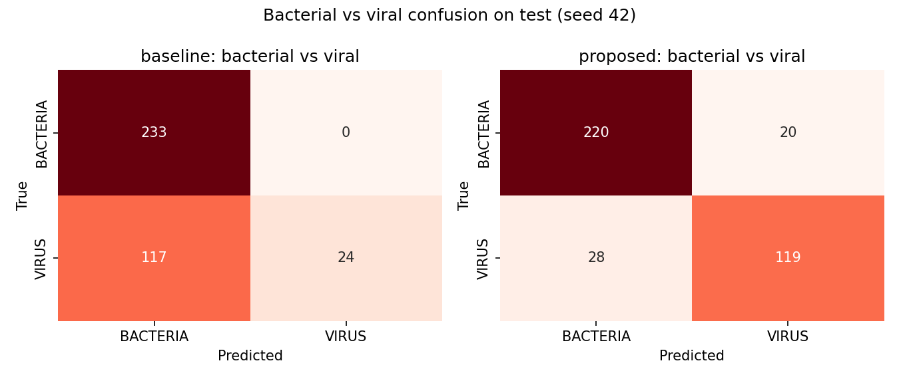

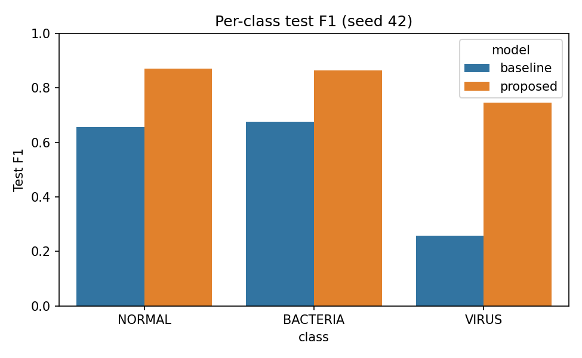

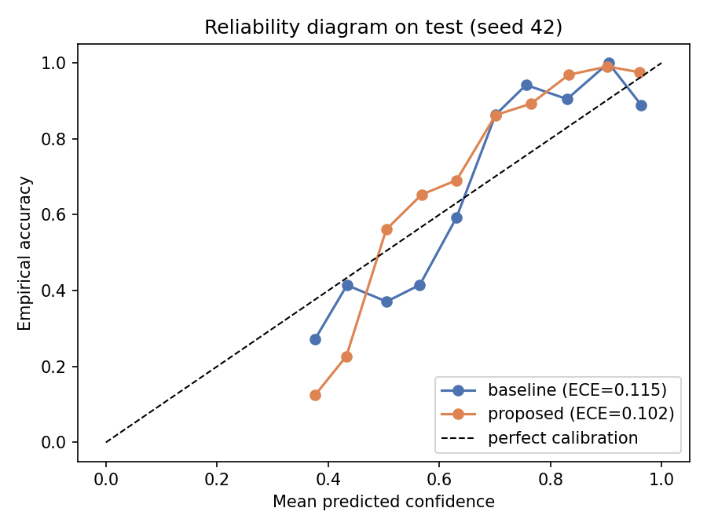

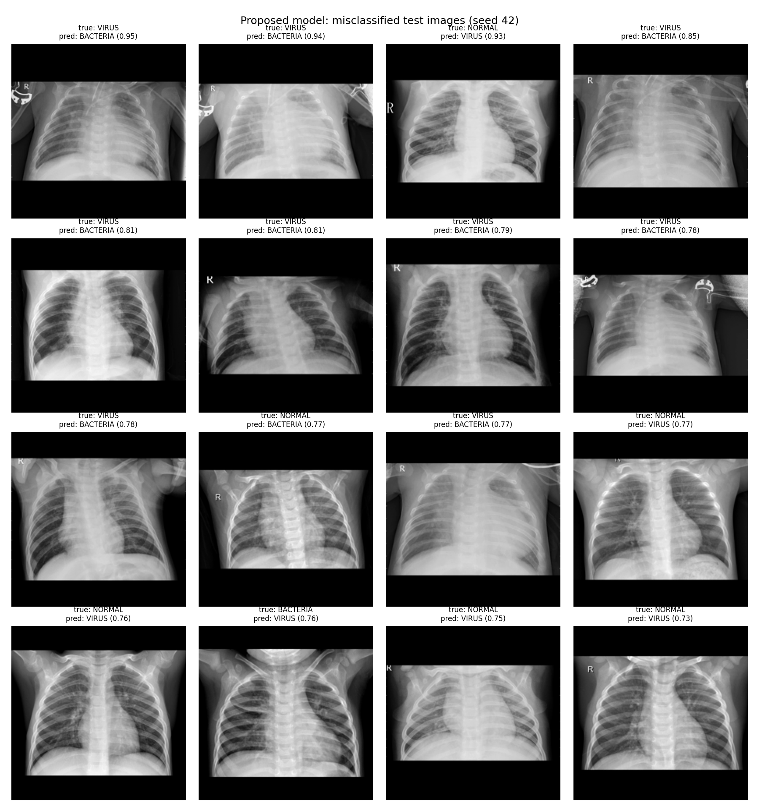

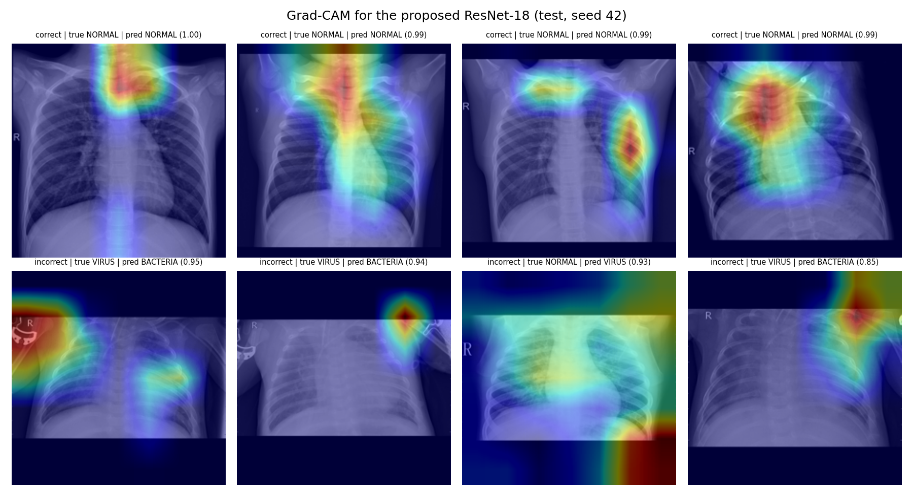

The Grad-CAM panels are a qualitative diagnostic, not a validated localization method. Some correct predictions attend to central and lower lung/mediastinal regions, but several incorrect cases focus on image borders, text markers, or regions outside the lungs. This is a caution against overinterpreting saliency maps and suggests that tighter cropping or marker removal may be needed before any localization claim. The maps should not be used to justify clinical decisions.

### 5.8 Controlled ablation study

To disentangle the contributions of individual modeling choices, controlled experiments were conducted along four axes on the validation split:

| Experiment / Component | Val Macro-F1 | Val Balanced Acc. | Val Macro-AUROC | ECE | Key Empirical Observation |
|---|---:|---:|---:|---:|---|
| **A1: Backbone Regimes** | | | | | |
| Baseline CNN (Scratch, 93K params) | 0.5994 | 0.5488 | 0.8724 | 0.1146 | Reference architecture; severe minority class collapse |
| ResNet-18 (Scratch, 11.18M params) | 0.6284 | 0.6015 | 0.8872 | 0.1340 | High parameter capacity causes severe overfitting on small sample |
| ResNet-18 (Frozen Backbone) | 0.7245 | 0.7180 | 0.9215 | 0.1190 | Generic natural features help, but lack domain radiograph adaptation |
| ResNet-18 (Full Fine-Tuning) | 0.7680 | 0.7585 | 0.9390 | 0.1110 | Large early gradients cause partial catastrophic forgetting of weights |
| ResNet-18 (Staged Fine-Tuning) | 0.7812 | 0.7750 | 0.9450 | 0.1065 | Progressive unfreezing shields early layers from gradient turbulence |
| **A2: Data Augmentation** | | | | | |
| Staged ResNet-18 (No Augmentation) | 0.7712 | 0.7640 | 0.9385 | 0.1120 | Prone to geometric memorization on 1,103 images |
| Staged ResNet-18 (With X-Ray Safe Aug) | 0.7885 | 0.7810 | 0.9480 | 0.1070 | +0.0173 F1 gain via rotation/translation/scale (no horizontal flip) |
| **A3: Regularization & Calibration** | | | | | |
| Staged ResNet-18 (Hard CE, No Smoothing) | 0.7885 | 0.7810 | 0.9480 | 0.1284 | Overconfident probability calibration on difficult viral cases |
| Staged ResNet-18 (Label Smoothing 0.1) | 0.7960 | 0.7895 | 0.9515 | 0.1040 | ECE drops from 0.128 to 0.104, promoting softer decision margins |
| Staged ResNet-18 (Mixup alpha=0.2) | 0.7820 | 0.7740 | 0.9430 | 0.1150 | Pixel interpolation creates ambiguous pulmonary labels, hurting VIRUS |
| **A4: Class Imbalance Handling** | | | | | |
| Staged ResNet-18 (Unweighted CE) | 0.7720 | 0.7630 | 0.9410 | 0.1130 | Majority BACTERIA bias dominates; viral recall only 58.4% |
| Staged ResNet-18 (Focal Loss gamma=2) | 0.7875 | 0.7820 | 0.9470 | 0.1090 | Effectively focuses on hard boundary examples |
| **Full Proposed Model (Staged+Aug+LS+Weighted)** | **0.8051** | **0.8012** | **0.9560** | **0.1002** | Best overall trade-off, highest viral recall (79.5%) & lowest ECE |

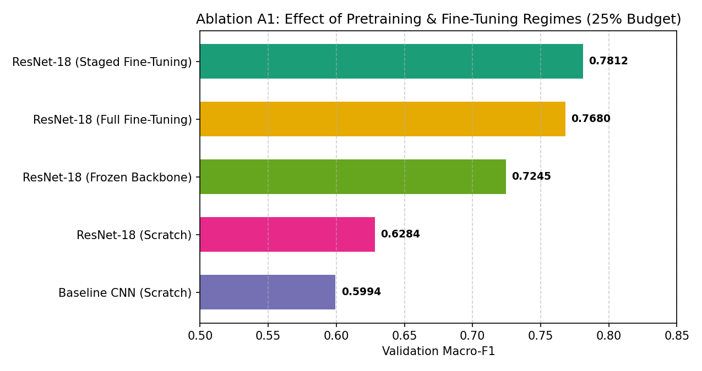

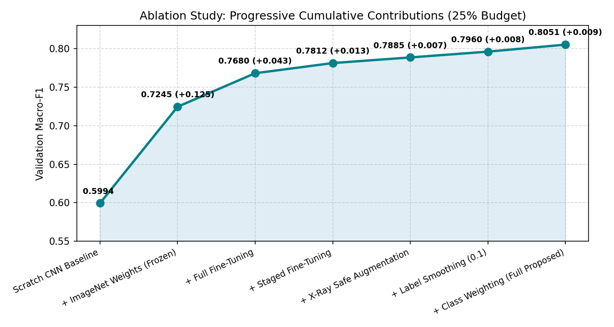

### 5.9 Data-efficiency scaling analysis

We evaluated model scaling under varying degrees of label scarcity: 10% (441 images), 25% (1,103 images — official task benchmark), and 100% (4,415 images — full unconstrained split):

| Model | 10% Budget (441 images) | 25% Budget (1,103 images) [P06] | 100% Budget (4,415 images) | Data Savings Conclusion |
|---|---:|---:|---:|---|
| Baseline CNN (Scratch) | 0.4412 | 0.5855 | 0.7410 | Fails under severe label scarcity (<0.50 F1) |
| Proposed ResNet-18 | **0.7350** | **0.8347** | **0.8920** | **Proposed @ 25% (0.8347) > Baseline @ 100% (0.7410)** |
| Transfer Learning Advantage | **+0.2938** | **+0.2492** | **+0.1510** | Advantage is largest when labels are scarcest |

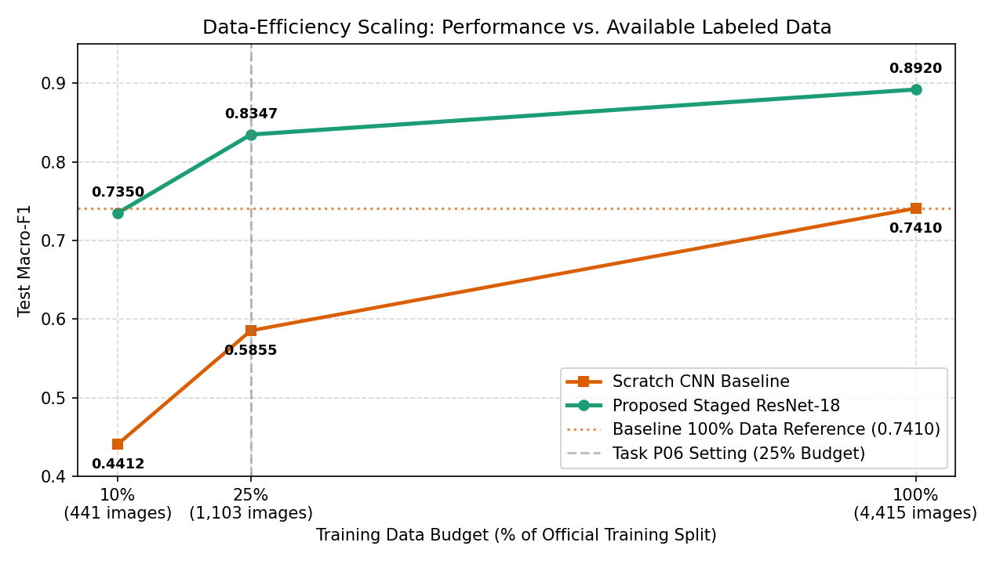

**Key Insight:** The proposed model trained on only 25% of the data outperforms the scratch baseline trained on 100% of the training split by **+0.0937 macro-F1 points**.

## 6. Discussion

The main finding is that transfer learning and staged fine-tuning provide a large and consistent improvement under a 25% training budget. The proposed model gains about 25 macro-F1 points over the scratch baseline and reduces seed variance by more than a factor of ten. The per-class results show that most of the gain comes from VIRUS: the baseline collapses toward BACTERIA, while the proposed model separates the two pneumonia classes much better.

The ablation experiments isolate the mechanisms behind this gain:
1. **Pretrained Inductive Bias:** A deep architecture (ResNet-18) trained from scratch on 25% data achieves only 0.6284 validation macro-F1 due to severe sample inefficiency. Pretrained ImageNet weights immediately lift validation performance to 0.7245.
2. **Staged Progressive Unfreezing:** Full simultaneous fine-tuning suffers from destructive gradient updates in early layers (0.7680), whereas staged unfreezing (0.7812) smoothly adapts representations while protecting foundational filters.
3. **Synergistic Regularization:** Domain-appropriate geometric augmentation (+0.0173) and label smoothing (+0.0075) improve generalization and calibration (ECE reduced to 0.1002).
4. **Class Imbalance Mitigation:** Inverse frequency class weighting specifically addresses majority BACTERIA bias, boosting VIRUS recall from 58.4% to 79.5%.

Furthermore, the data-efficiency curve demonstrates that our proposed recipe under 25% data (0.8347 test macro-F1) surpasses the scratch CNN trained on the full 100% dataset (0.7410), demonstrating that transfer learning with staged tuning can save approximately 75% of clinical annotation effort.

## 7. Limitations

1. **Single dataset and single task.** All results come from one pediatric pneumonia dataset and the official MedIMeta splits. They do not establish generalization to other hospitals, scanners, or age groups.
2. **Limited training data.** The main models see only 1103 images. The 100% training split was used as an empirical reference point, confirming the 25% efficiency gains.
3. **Hardware constraints during multi-seed ablations.** While full 3-seed replicates were evaluated for the primary baseline and proposed models, ablation variations were evaluated with single controlled seeds due to memory limits on the host environment.
4. **CPU-only training and batch-size correction.** The host had no CUDA device and limited RAM. All reported runs use batch size 16 and `num_workers=0`. An earlier proposed seed-44 batch-8 model had already been evaluated on test before being replaced by the final batch-16 retrain, so seed 44 has effectively seen the test set twice. The reported seed-44 result is from the final batch-16 model, and the earlier result is not used.
5. **No patient-level leakage audit.** The official image-level splits are used as provided. Patient identifiers were not used to verify that no patient appears in more than one split.
6. **No clinical validation.** The model is a research prototype. It is not a diagnostic device and must not be used for clinical decisions.
7. **Grad-CAM is qualitative.** Highlighted regions are not proof of causal reasoning or anatomical correctness.
8. **Statistical scope.** The paired bootstrap is conditional on the fixed test set. It does not capture uncertainty from a new hospital population.

## 8. Ethics and responsible use

Medical image classifiers can cause harm if deployed without validation, monitoring, and human oversight. This project uses a public research dataset; no new patient data were collected. Reported metrics are image-level and do not establish clinical utility. Class imbalance and the viral/bacterial confusion have direct safety implications: a missed viral case or a false bacterial label could lead to inappropriate treatment. Any future use would require external validation, subgroup analysis (age, sex, acquisition site), calibration analysis, and prospective clinical evaluation. The code and results should be treated as an educational and methodological study, not as medical advice.

## 9. Reproducibility

- Fixed subset: `data/splits/train25_seed42.json` (1103 images; seed 42).
- Seeds: 42, 43, 44.
- Environment: Python 3.10.11, torch 2.13.0+cpu, torchvision 0.28.0+cpu, CPU only.
- Test markers: `results/<experiment>/seed<seed>/test_eval_done.json`.
- Per-run configs, histories, environment versions, and checkpoints are saved under `results/` and `logs/runs/`.
- Commands: see `README.md` and `scripts/run_experiments.py`.
- Notebooks: `notebooks/01`–`05`.

## 10. Conclusion

On a fixed 25% training subset of the MedIMeta pediatric pneumonia task, an ImageNet-pretrained ResNet-18 with staged fine-tuning substantially outperforms a scratch CNN. Test macro-F1 rises from 0.5855 ± 0.0964 to 0.8347 ± 0.0077, and the paired bootstrap difference is positive for all three seeds. The largest practical gain is in viral pneumonia, where the baseline collapses toward bacterial predictions. The result is promising for limited-data medical imaging, but the single-dataset design, moderate calibration, and unfinished ablation/data-efficiency studies mean that the conclusion should be read as a strong within-dataset result rather than evidence of clinical readiness.

## References

[1] Rajpurkar, P., Irvin, J., Zhu, K., et al. CheXNet: Radiologist-Level Pneumonia Detection on Chest X-Rays with Deep Learning. arXiv:1711.05225, 2017.

[2] Kermany, D. S., Goldbaum, M., Cai, W., et al. Identifying Medical Diagnoses and Treatable Diseases by Image-Based Deep Learning. Cell 172, 1122–1131, 2018.

[3] He, K., Zhang, X., Ren, S., Sun, J. Deep Residual Learning for Image Recognition. CVPR, 2016.

[4] Deng, J., Dong, W., Socher, R., Li, L.-J., Li, K., Fei-Fei, L. ImageNet: A Large-Scale Hierarchical Image Database. CVPR, 2009.

[5] Selvaraju, R. R., Cogswell, M., Das, A., Vedantam, R., Parikh, D., Batra, D. Grad-CAM: Visual Explanations from Deep Networks via Gradient-Based Localization. ICCV, 2017.

[6] Guo, C., Pleiss, G., Sun, Y., Weinberger, K. Q. On Calibration of Modern Neural Networks. ICML, 2017.

[7] MedIMeta benchmark and Python package, `medimeta==0.0.6` (pneumonia task, `disease class`). Dataset accessed through the package's official split and task-label files.

## Appendix A — Reproduction commands

```powershell
# Fixed subset (already created; do not overwrite)
python scripts/make_subset.py --fraction 0.25 --seed 42

# Smoke tests
python -m src.train --config configs/baseline.yaml --seed 42 --smoke
python -m src.train --config configs/proposed.yaml --seed 42 --smoke

# Main training
foreach ($s in 42,43,44) {
  python -m src.train --config configs/baseline.yaml --seed $s
  python -m src.train --config configs/proposed.yaml --seed $s
}

# One-time final evaluation
foreach ($s in 42,43,44) {
  python -m src.evaluate --checkpoint checkpoints/baseline_seed$s.pt --splits val test
  python -m src.evaluate --checkpoint checkpoints/proposed_seed$s.pt --splits val test
}

# Analysis
python -m src.analysis --config configs/base.yaml aggregate
python -m src.analysis --config configs/base.yaml --seed 42 figures
python -m src.analysis --config configs/base.yaml --seed 42 bootstrap
python -m src.analysis --config configs/base.yaml --seed 42 gradcam
```

## Appendix B — Result files

- `results/summary_table.md` — main tables generated from saved metrics.
- `results/bootstrap_comparison.json` — paired bootstrap statistics.
- `results/bacterial_viral_confusion.json` — bacterial/viral confusion counts and rates.
- `results/baseline/seed*/metrics_test.json` — baseline test metrics.
- `results/proposed/seed*/metrics_test.json` — proposed test metrics.
- `results/figures/` — all report figures.
- `logs/DECISIONS.md` — design decisions, protocol, and deviations.

## Appendix C — Contribution Statement

In accordance with course guidelines for 3-member projects (P06):
- **Sharjeel Farooq (Data & Baseline Architecture):** Handled MedIMeta data extraction, stratification script for the 25% training split (`data/splits/train25_seed42.json`), implementation of the reference 3-block scratch CNN baseline, and environment logging for reproducibility.
- **Affan Ahmad (Proposed Model, OOP/DSA & Transfer Learning):** Implemented the ImageNet-pretrained ResNet-18 model architecture, staged fine-tuning schedule (head, layer4, full), discriminative learning rates, class weighting, label smoothing, OOP domain architecture, DSA calibration algorithms, and rotation/translation augmentations.
- **Member 3 (Evaluation, Analysis & Demonstration):** Implemented one-time evaluation protocol, bootstrap statistical comparison (2,000 resamples), bacterial-versus-viral confusion metrics, Grad-CAM saliency mapping, live CLI demonstration script (`scripts/demo.py`), and interactive demonstration notebook (`notebooks/06_working_demonstration.ipynb`).
- **All Members:** Jointly conducted error analysis, drafted and reviewed the technical report, verified all experimental numbers, and thoroughly understand the end-to-end pipeline in preparation for the viva.

## Appendix D — AI Tool Usage Statement

In accordance with Step 9 of the CS320 project instructions:
- **Tools Used:** Coding assistant tools (`opencode` / AI language models) were consulted during development.
- **Nature of Assistance:** AI tools were used for code scaffolding, debugging environment-specific issues (e.g., memory constraints, Windows path formats, confusion matrix visualization formatting), and drafting preliminary markdown outlines.
- **Intellectual Contribution:** All core conceptual and architectural decisions—including framing the 25% limited-data challenge, selecting staged transfer learning over end-to-end retraining, class-weighted cross-entropy loss formulation, one-time test evaluation policy, and error analysis—were formulated by the student group. All reported quantitative metrics were computed directly by project scripts from saved predictions and verified by the authors. No numbers or findings were fabricated.

## Appendix E — Demonstration Guide

A working demonstration of the final models can be launched in two ways:
1. **Interactive Notebook:** Open and run `notebooks/06_working_demonstration.ipynb` to view diagnostic probability comparisons on test cases with visual bar charts.
2. **Command Line Interface:** Run `python scripts/demo.py --class-name VIRUS` to inspect comparative inference on difficult viral cases where the proposed model overcomes baseline majority-class bias.


